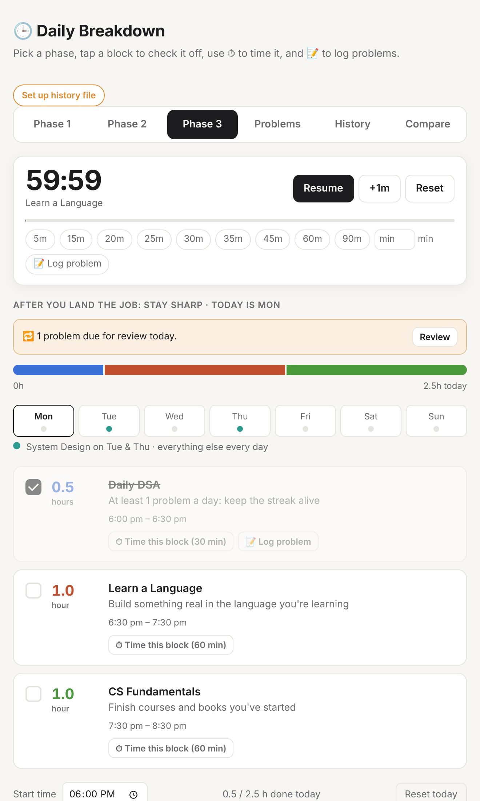
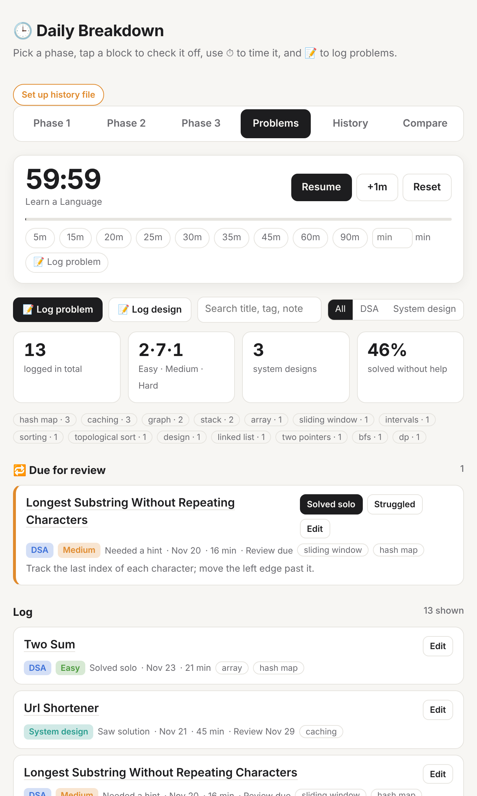
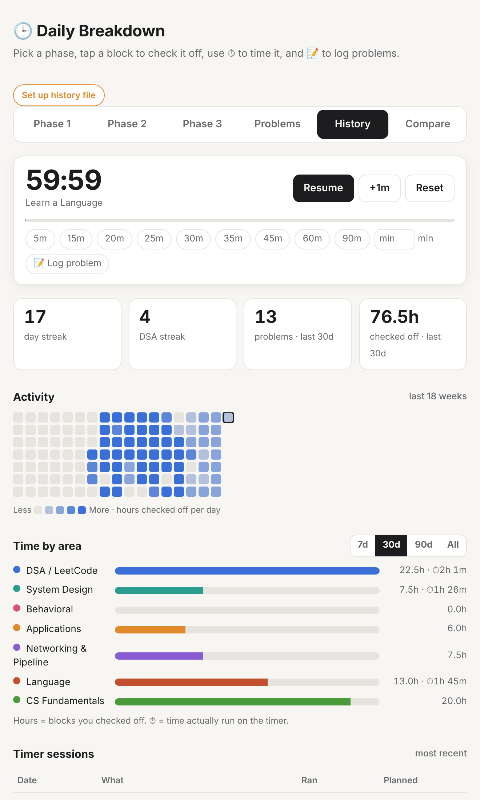

# 🕒 Daily Breakdown

**A small offline planner for software-engineering interview prep. It also helps you stay sharp after you're hired.**

Daily Breakdown splits your day into time blocks, such as DSA practice, system design, applications and learning a new language, and organizes them into **phases** that follow a job search:

| Phase | When | Focus |
|---|---|---|
| **Phase 1: Build the foundation** | Early in the search | Learning DSA patterns and system design building blocks, behavioral stories, tailored applications, networking |
| **Phase 2: Interview mode** | Interviews are happening | Timed, unseen DSA problems, full system design mocks, managing your interview pipeline |
| **Phase 3: Stay sharp** | After you land the job | A daily DSA problem, system design twice a week, steady language and CS learning, and an interview every 1–3 months so your skills stay current |

Every phase includes DSA and system design, and every phase is fully customizable. You can rename blocks, change the hours, add phases, or swap categories by editing one clearly marked section of the HTML file.

It's a **single HTML file**. There's nothing to install beyond a browser: no account, no server and no tracking. Your history goes into a plain `history.json` file that **you own**. Keep it on your computer, or sync it with Dropbox, iCloud, Syncthing or Git.

<p align="center">
  
  
  
</p>

## Features

- **📋 A daily plan for each phase.** Tap a block to check it off. Set a start time and every block shows its time slot. Blocks can be limited to certain weekdays, such as system design on Tuesday and Thursday.
- **⏱ Countdown timer.** Presets from 5 to 90 minutes, any custom length, and "Time this block" to load a block's length. It beeps when time's up, shows the time left in the window title, and keeps running if you close and reopen the page.
- **📝 Problem log.** Paste a LeetCode, NeetCode or system design link and the name fills in. Record the difficulty, how it went, tags, notes and minutes spent (taken from the timer).
- **🔁 Review list.** Anything you needed help with comes back after 3, then 7, then 30 days.
- **📈 History.** Day streak, DSA streak, an activity calendar, hours per area, recent timer sessions and an interview log.
- **🎯 Stay-interview-ready tracker** in Phase 3. It tells you when you're due for another interview.
- **💾 Your data, your file.** Saves automatically to `history.json`, merges changes between computers, and exports backups and CSV files.

## Requirements

- **Google Chrome**, **Microsoft Edge**, **Brave** or **Chromium**, on Windows, macOS or Linux.
  Saving straight to `history.json` uses the browser's [File System Access API](https://developer.mozilla.org/docs/Web/API/File_System_API), which only Chromium-based browsers support. Firefox and Safari can still run the page, but they keep history inside the browser and you back it up with Export.

## Installation

### 1. Get the files

Download the repo as a ZIP (green **Code** button → **Download ZIP**) and unzip it, or clone it:

```bash
git clone https://github.com/WiddiCodes/daily-breakdown.git
```

Put the folder somewhere permanent, such as `Documents/daily-breakdown`. The launchers look for `daily-breakdown.html` next to themselves, so if you move the folder later, run the installer again.

### 2. Run the installer for your system

Each installer adds a launcher that opens the page in a small window without tabs or an address bar, and sets it to open when you log in.

<details open>
<summary><b>Windows</b></summary>

1. Double-click **`install-windows.bat`**.
2. "Daily Breakdown" now appears in your Start menu and opens when you sign in.

To undo, open a Command Prompt in the folder and run `install-windows.bat remove`.
To open it once without installing, double-click **`Open Daily Breakdown.bat`**.
</details>

<details>
<summary><b>macOS</b></summary>

1. Open **Terminal**, type `bash ` (with a space after it), drag **`install-mac.sh`** into the window, and press Return.
2. This creates **`~/Applications/Daily Breakdown.app`**. Open it with Spotlight or drag it to the Dock. It also opens when you log in. macOS may show a "Background item added" notice.

To undo, run `bash install-mac.sh remove`.
To open it once without installing, run `bash open-daily-breakdown-mac.command`.
</details>

<details>
<summary><b>Linux</b></summary>

1. In a terminal in the folder, run:
   ```bash
   bash install-linux.sh                 # app menu entry + open at login
   bash install-linux.sh --no-autostart  # app menu entry only
   ```
2. "Daily Breakdown" appears in your app menu.

To undo, run `bash install-linux.sh remove`.
To open it once without installing, run `bash open-daily-breakdown-linux.sh`.

Snap-packaged Chromium can only open files in your home folder (not hidden folders), so keep the folder there.
</details>

You can also just open `daily-breakdown.html` in your browser. The launchers only make it feel like an app.

### 3. Choose where to save your history

The first time the page opens, it asks:

- **Create history.json**: start a new history file. Pick any folder, ideally a synced one.
- **Open existing**: connect to a `history.json` you already use on another computer.

After that, everything saves automatically. The pill in the top right shows the status. Chrome may occasionally ask (usually after a restart) whether the page can keep editing the file. Click **Allow**. If Chrome offers "Allow on every visit", choose that.

### Using it on more than one computer

Put `history.json` in a folder that a sync tool keeps up to date, such as Dropbox, iCloud Drive, OneDrive, Syncthing or a private Git repo. On each computer, choose **Open existing** and pick that file. The page re-reads the file when its window gets focus and every minute, and merges changes item by item. If the same item was edited in two places, the newest edit wins.

> ⚠️ Don't commit your `history.json` to a **public** repo. The included `.gitignore` already excludes it.

## Customizing your phases

Everything you can change is in **one section near the top of the `<script>` in `daily-breakdown.html`**, between these two lines:

```js
/* =====================================================================
   ✏️  CONFIG: the only part of this file you need to edit.
   ...
/* =========================== end of CONFIG =========================== */
```

Open the file in any text editor, such as VS Code, Notepad++, TextEdit (Format → Make Plain Text) or nano. Change the config, save, and reload the page. If you make a mistake, the page shows a **red box** that says what's wrong and where. It doesn't just break.

### How the config is organized

```js
const CONFIG = {
  appName: "Daily Breakdown",
  storageId: "daily-breakdown",
  timerPresets: [5, 15, 20, 25, 30, 35, 45, 60, 90],
  reviewSteps: [3, 7, 30],
  interviewEvery: { min: 30, max: 90 },

  categories: {
    dsa:  { name: "DSA / LeetCode", color: "#3b6fd8", log: "dsa" },
    sd:   { name: "System Design",  color: "#2a9d8f", log: "sd"  },
    lang: { name: "Language",       color: "#c2502e" },
    // ...
  },

  phases: [
    {
      id: "p1",
      title: "Phase 1",
      subtitle: "Job search: build the foundation",
      start: "08:00",
      blocks: [
        { id: "p1-dsa", category: "dsa", hours: 2, name: "Data Structures & Algorithms",
          detail: "Focused topic mastery: one pattern at a time" },
        // ...
      ],
    },
    // ...
  ],
};
```

**Block fields**

| Field | Required | What it does |
|---|---|---|
| `id` | ✅ | A unique, permanent name for the block, used to save your check-offs. Don't rename it once you have history. |
| `category` | ✅ | One of the keys in `categories`. Sets the color and where its hours are counted in History. |
| `hours` | ✅ | Length of the block. Fractions are fine: `0.25` = 15 min, `0.5` = 30 min, `0.75` = 45 min. |
| `name` | ✅ | What the block shows as its title. |
| `detail` | | A line of explanation under the name. |
| `days` | | Only show the block on these weekdays, for example `["Tue", "Thu"]`. Leave it out for every day. |
| `labels` | | Small tags under the block, for example `["Week 1: write", "Weeks 2–3: review"]`. |

**Phase fields:** `id` (unique; can't be `problems`, `history` or `compare`), `title` (the tab label), `subtitle`, `start` (default start time, 24-hour), `blocks`, and `showInterviewTracker: true` to show the interview card.

**Category fields:** `name`, `color` (any CSS color), and optionally `log: "dsa"` or `log: "sd"`. Blocks in a category with `log` get a **📝 Log problem** or **📝 Log design** button, and `log: "dsa"` categories count toward the DSA streak.

### Tutorial: common changes

#### 1. Change how long a block is
Find the block and change `hours`. To make Phase 1's DSA block 3 hours:
```js
{ id: "p1-dsa", category: "dsa", hours: 3, name: "Data Structures & Algorithms", ... },
```
The time slots and daily total update automatically.

#### 2. Make the generic blocks your own
The "Learn a Language" and "CS Fundamentals" blocks are placeholders. Rename them to what you're actually doing. Keep the `id` the same.
```js
{ id: "p3-lang", category: "lang", hours: 1, name: "Learn Rust",
  detail: "Work through the Rust Book, then build a CLI tool" },
{ id: "p3-cs",   category: "cs",   hours: 1, name: "Operating Systems course",
  detail: "One lecture + one problem set" },
```
Rename the category too, so History says "Rust" instead of "Language":
```js
lang: { name: "Rust", color: "#c2502e" },
```

#### 3. Add a block
Copy an existing block line, paste it where you want it in the list (blocks appear in list order), and give it a **new unique id**:
```js
{ id: "p1-mock", category: "beh", hours: 0.5, name: "Mock Interview",
  detail: "One peer mock per day", days: ["Mon", "Wed", "Fri"] },
```

#### 4. Remove a block
Delete its line. Old check-offs for it stay in your history file but no longer count toward the plan.

#### 5. Only show a block on some days
Add `days`:
```js
{ id: "p3-sd", category: "sd", hours: 0.75, name: "System Design", days: ["Tue", "Thu"] },
```
The phase shows a week strip with dots for those days, and the block is hidden on other days.

#### 6. Add a new category
Add an entry to `categories`, then use its key in blocks:
```js
categories: {
  // ...
  ml: { name: "Machine Learning", color: "#e0a500" },
},
// ...
{ id: "p1-ml", category: "ml", hours: 1, name: "ML Fundamentals", detail: "fast.ai lesson" },
```
Add `log: "dsa"` if you want a "Log problem" button on its blocks, for example for a second kind of coding practice.

#### 7. Add, remove or reorder phases
Phases are a list. Each `{ ... }` is one tab, shown in order. To add a fourth phase, such as a lighter weekend schedule, copy a whole phase and change its `id`, `title` and block ids:
```js
{
  id: "weekend",
  title: "Weekend",
  subtitle: "Light review only",
  start: "10:00",
  blocks: [
    { id: "we-dsa",  category: "dsa", hours: 1, name: "Review list problems" },
    { id: "we-read", category: "cs",  hours: 1, name: "Reading" },
  ],
},
```
To remove a phase, delete its whole `{ ... }` entry. Watch the commas: there should be one between phases.

#### 8. Timer presets, review intervals and interview cadence
```js
timerPresets: [10, 25, 30, 45, 60],      // timer buttons, in minutes
reviewSteps: [2, 5, 14, 30],             // days until each review
interviewEvery: { min: 45, max: 120 },   // "interview every 45–120 days"
```

#### 9. Run two separate copies
Say you want one copy for interview prep and one for a different routine. Copy the HTML file, change `appName`, and **give it a different `storageId`** so the copies don't share saved data in the browser. Each copy should also use its own `history.json`.

### Tips

- **Keep ids stable.** Changing a block's `name`, `hours` or `detail` is always safe. Changing its `id` makes the page treat it as a new block.
- **Commas and quotes are what usually break.** Every block and every phase is followed by a comma, and text goes in `"double quotes"`. The red error box will help, and so will your editor's syntax highlighting.
- **Reload to see changes.** Press Ctrl+R (⌘R on Mac) in the window.

## How your data is stored

`history.json` is plain, readable JSON:

```json
{
  "version": 1,
  "app": "daily-breakdown",
  "days":       { "2026-11-23": { "p3": { "done": ["p3-dsa", "p3-lang"], "t": 1795450000000 } } },
  "problems":   [ { "id": "…", "date": "2026-11-23", "kind": "dsa", "url": "https://leetcode.com/problems/two-sum/",
                    "title": "Two Sum", "diff": "Easy", "result": "solo", "min": 18, "tags": ["array"],
                    "notes": "", "review": null } ],
  "sessions":   [ { "id": "…", "date": "2026-11-23", "label": "Daily DSA", "cat": "dsa", "planned": 30, "actual": 1720 } ],
  "interviews": [ { "id": "…", "date": "2026-09-01" } ]
}
```

- `t` is the time an item last changed. It's used to merge edits from different computers.
- Deleted items stay as `{"id": "…", "deleted": true}` so the deletion also reaches your other computers.
- If the file is ever damaged (not valid JSON), the page refuses to overwrite it and shows a warning.

**History → Your data** has buttons to export a full `.json` backup, export problems or daily hours as `.csv`, and import a backup and merge it in.

## FAQ

**Does it send my data anywhere?**
No. The page makes no network requests except loading the Inter font from Google Fonts. If you're offline, it falls back to your system font.

**I opened it in Firefox or Safari and there's no "Create history.json" button.**
Those browsers don't support saving straight to a file. History is kept in the browser; use **History → Export backup** to save a copy.

**Chrome keeps asking me to "Allow".**
That's Chrome's file-permission prompt. Newer versions of Chrome offer "Allow on every visit", which stops the repeated prompts.

**The page opened in a normal browser tab instead of its own window.**
The launcher couldn't find Chrome, Edge, Brave or Chromium, so it opened your default browser instead. Install one of them and run the installer again. On Windows, if your browser is installed somewhere unusual, add its path to the list in `Open Daily Breakdown.bat`.

**Can I use it on my phone?**
The page works in a mobile browser, but phones can't save to `history.json`. History stays in that browser.

## License

[MIT](LICENSE)
